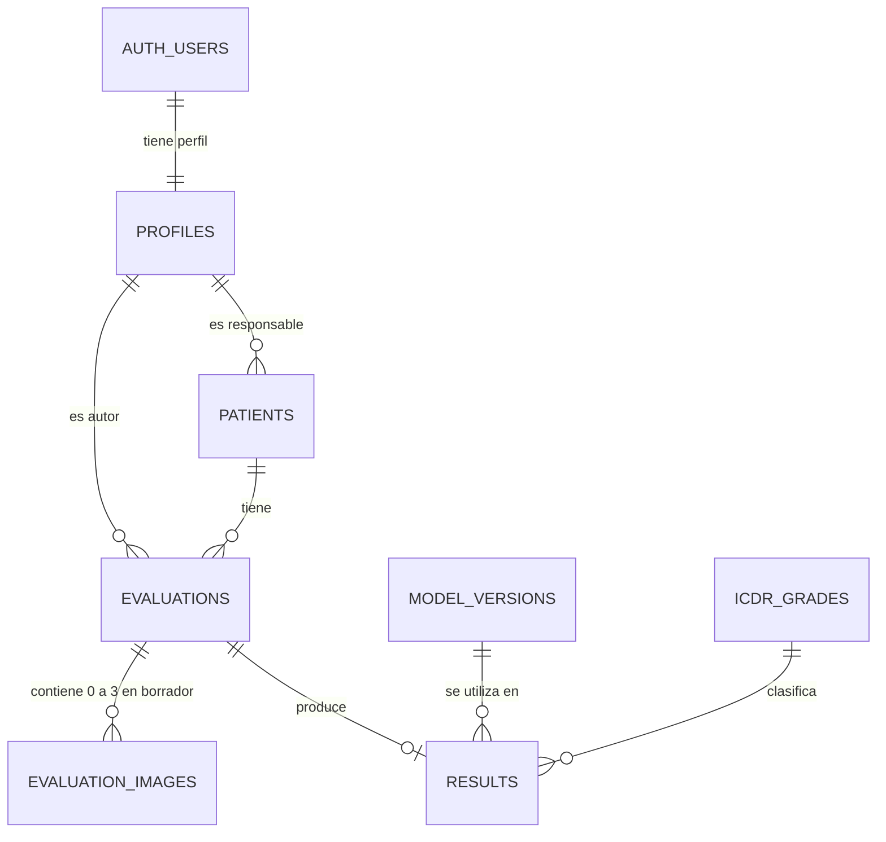

# Retinazo: tablas, relaciones y normalización

Diseño inicial del 2 de noviembre de 2026. Objetivo de normalización: tercera forma normal (3FN), bajo las dependencias y reglas descritas aquí. No es una afirmación de haber auditado todas las formas normales superiores.

El usuario ha definido: cada profesional consulta y edita sus propios pacientes. La cuenta administradora gestiona todos los expedientes y las cuentas. El proyecto Supabase Retinazo ya está creado y los adaptadores Flutter están implementados. Las tres migraciones están aplicadas y el administrador inicial está configurado. Se comprobaron autenticación, lecturas y protección de roles en el proyecto alojado; el flujo completo en teléfono y la entrega de correo siguen pendientes.

## Tablas y responsabilidades

Son siete tablas propias en `public`, más `auth.users`, que ya administra Supabase:

| Tabla | Clave primaria | Datos principales | Responsabilidad |
|---|---|---|---|
| `auth.users` | `id` | Identidad, correo y confirmación administrados por Auth | Autenticación; no se crea ni modifica su estructura en la migración |
| `profiles` | `id`, también FK a `auth.users.id` | `full_name`, `role`, `is_active`, fechas | Perfil de una cuenta, profesional o administradora |
| `patients` | `id` | `owner_id`, DNI, nombres, apellidos, nacimiento, sexo, teléfono, dirección, historia clínica | Expediente privado de un profesional |
| `evaluations` | `id` | `patient_id`, `professional_id`, ojo, observaciones, estado y fechas | Una evaluación de un ojo en un momento determinado |
| `evaluation_images` | `(evaluation_id, position)` | SHA-256, tipo, tamaño, dimensiones, estado de carga, bucket/clave opcionales | Una posición de imagen dentro de una evaluación |
| `model_versions` | `id` | Nombre, versión y hash opcional del artefacto | Identificar el modelo utilizado en una predicción futura |
| `icdr_grades` | `grade` | Código 0–4 y etiqueta | Catálogo de grados, sin recomendaciones clínicas automáticas |
| `results` | `evaluation_id`, también FK | `model_version_id`, `icdr_grade`, confianza opcional, fecha de predicción | Un resultado vigente por evaluación |

`PK` identifica una fila. `FK` enlaza una fila con otra existente. Un UUID es el identificador interno; el DNI se almacena como texto para conservar ceros iniciales.

El correo y las credenciales permanecen en Auth: no se duplican en `profiles`, ni se crean contraseñas en tablas de pacientes. Nombre del perfil y nombre del paciente son datos de personas con funciones distintas.

## Relaciones



- **Cuenta–perfil, 1:1:** el perfil usa el mismo UUID de la cuenta. Un trigger lo crea al registrarse; un backfill cubre cuentas anteriores a la migración. Un fallo del trigger puede impedir el alta, por eso se prueba.
- **Perfil–paciente, 1:N:** un profesional puede tener ningún paciente o muchos; cada expediente tiene un responsable. El administrador también puede registrar pacientes a su cargo.
- **Paciente–evaluación, 1:N:** un paciente puede tener varias evaluaciones, de ambos ojos y de distintas fechas. El ojo pertenece a la evaluación y no a la identidad del paciente.
- **Perfil–evaluación, 1:N:** cada evaluación conserva su autor. La responsabilidad del expediente y la autoría histórica son hechos distintos; no deben intercambiarse al reasignar un expediente. El profesional crea evaluaciones de sus pacientes; el administrador puede crearlas para cualquier paciente con su propia identidad como autor.
- **Evaluación–imagen, 1:N con límite:** un borrador admite 0–3 posiciones. Para pasar a pendiente de análisis, no graduable o completada necesita exactamente tres filas con carga confirmada en sus metadatos.
- **Evaluación–resultado, 1:0..1:** un borrador o una evaluación pendiente/no graduable no lleva predicción; una completada debe tener exactamente una. El modelo futuro podrá requerir un historial de ejecuciones; ese N:M no se implementa por adelantado.
- **Versión–resultado y grado–resultado, 1:N:** muchos resultados pueden usar la misma versión y el mismo grado. No se repiten sus descripciones en cada predicción.

No hay una tabla `eyes` porque aquí derecho/izquierdo es un valor de una evaluación, sin otros atributos propios. No hay una tabla de bucket proveedor porque aún no se eligió ni se integró uno.

## Expedientes privados y DNI

La restricción `UNIQUE (owner_id, dni)` evita registrar dos veces el mismo DNI dentro de un profesional. El mismo DNI puede existir en los expedientes privados de dos profesionales. Son dos expedientes, no dos cuentas de paciente. El administrador podría ver ambos.

Esta es una decisión de alcance, no una consecuencia obligatoria de la normalización. Si se requiere una única ficha de paciente para todo un centro, habrá que cambiar este diseño antes de usar datos reales: un padrón único y una tabla de asignaciones paciente–profesional permitirían compartir acceso sin duplicar la identidad. El alcance actual elegido es el de expedientes privados.

## Formas normales, paso a paso

Normalizar organiza los hechos para reducir repeticiones y anomalías de alta, edición y eliminación. No equivale a dividir todos los campos en tablas. Se analizan las claves candidatas y las dependencias funcionales, no solo los UUID.

### Paso 0: identificar los hechos

Una planilla inicial podría mezclar:

```text
DNI | paciente | profesional | ojo | fecha | fotos[] | grado | etiqueta_grado | nombre_modelo | version_modelo
```

Al repetir esto por visita, se repiten el nombre del paciente, el profesional y las descripciones de grado/modelo. Cambiar un nombre exige modificar varias filas; guardar un modelo sin evaluación o una evaluación aún sin resultado resulta incómodo.

Los hechos diferentes son: cuenta, perfil, expediente, evaluación, imagen, versión de modelo y resultado. Esa separación permite registrar un paciente sin exigirle una predicción.

### Paso 1: primera forma normal — 1FN

Para este modelo, cada atributo contiene un valor de su dominio y las filas se identifican por claves. No almacenamos la colección de fotos en una celda ni repetimos el mismo atributo en columnas `foto1`, `foto2`, `foto3`.

Creamos filas de imagen:

| evaluation_id | position | object_key |
|---|---|---|
| E1 | 1 | Referencia de primera imagen, cuando exista bucket |
| E1 | 2 | Referencia de segunda imagen |
| E1 | 3 | Referencia de tercera imagen |

Los nombres pueden contener varias palabras: siguen siendo un valor del atributo `first_names`. No se precisa separar cada palabra en una tabla para cumplir 1FN.

### Paso 2: segunda forma normal — 2FN

Debe cumplirse 1FN y cada atributo no primo depender de la totalidad de cada clave candidata, sin depender solo de una parte de una clave compuesta.

En imágenes, la clave `(evaluation_id, position)` identifica una posición concreta. El tamaño o hash de esa imagen depende de la posición completa. Si agregáramos `nombre_paciente` a esa tabla, dependería de `evaluation_id` a través de su paciente, no de la posición. Se repetiría tres veces. Por eso el paciente se obtiene mediante la relación con evaluaciones.

Tener una PK artificial de un campo no elimina por sí solo dependencias parciales de otras claves candidatas: también revisamos `(owner_id, dni)` en pacientes, `(model_name, version)` en modelos y las claves únicas alternativas de imágenes.

### Paso 3: tercera forma normal — 3FN

Debe cumplirse 2FN. Formalmente, para una dependencia funcional no trivial `X → A`, `X` debe ser una superclave o `A` un atributo primo. En este diseño evitamos dependencias transitivas entre datos no clave que describen entidades diferentes.

Ejemplos:

- `patient_id → datos del paciente`: sus nombres no se copian a cada evaluación.
- `professional_id → datos del perfil`: el nombre del autor se consulta desde perfiles.
- `model_version_id → nombre y versión`: resultados guarda la FK y no repite esos textos.
- `icdr_grade → label`: la etiqueta vive en el catálogo y no se copia en cada resultado.

Así, corregir una etiqueta no requiere actualizar todas las predicciones. Un resultado conserva qué versión se usó mediante una FK. Las modificaciones de una versión ya utilizada deben gestionarse como una nueva versión por el futuro servicio, no reescribiendo el significado de un identificador histórico.

No guardamos edad como columna: se calcula a partir de nacimiento y fecha de consulta para evitar que quede desactualizada. Esta es una decisión de integridad adicional al análisis de formas normales.

### ¿Hasta qué forma normal?

El objetivo práctico de este alcance es **3FN**. BCNF refuerza la regla: todo determinante de una dependencia no trivial debe ser una superclave. 4FN y 5FN tratan dependencias multivaluadas y de reunión más complejas. No hace falta introducir más tablas solo para afirmar un número superior; si aparecen nuevos requisitos, se revisarán las dependencias.

La normalización no sustituye permisos, transacciones, índices, reglas de captura ni validación clínica.

## Reglas de integridad

- DNI de 8 dígitos y teléfono opcional de 9; nombres obligatorios; nacimiento no futuro.
- Ojo `right`/`left` en evaluaciones; mapeo futuro con el enum español de Flutter.
- Posición de imagen 1–3, sin posición repetida y sin SHA-256 repetido dentro de una evaluación. Un hash debe calcularse desde los bytes en la futura integración; la base no lo calcula desde una foto inexistente.
- Las referencias al bucket pueden ser nulas mientras esté pendiente. Se almacena bucket + clave, no una URL firmada que caduca. Marcar una imagen como cargada exige referencias y fecha.
- Un borrador puede existir sin imágenes. Salir de borrador exige tres cargas; una completada exige resultado; una no graduable exige motivo y no recibe grado 0.
- Grado vinculado al catálogo 0–4; confianza opcional en [0,1], rechazando también NaN/infinito por el rango.
- Restricciones diferidas comprueban el estado final de una transacción. Se pueden insertar tres imágenes y finalizar en una transacción; una operación intermedia no deja un estado inválido al confirmar.
- Los cambios de imágenes/resultados se coordinan con un bloqueo del registro de evaluación. SQL garantiza metadatos coherentes; la existencia y contenido reales en el bucket requieren verificación del futuro backend.

Las FK preservan los registros clínicos: no se puede eliminar un perfil responsable o autor mientras existan referencias. No hay permiso de borrado clínico para el cliente. El cierre de sesión no elimina datos de PostgreSQL. La política de archivo/anulación se definirá si se solicita.

## Acceso y roles

| Acción | Profesional verificado | Administrador verificado | Sin sesión / sin confirmar correo |
|---|---|---|---|
| Leer perfiles | Propio | Todos | Sin sesión: denegado; cuenta pendiente: solo perfil propio si tiene JWT |
| Editar nombre de perfil | Propio | Todos mediante RPC | Denegado |
| Registrar pacientes | Propios | A su cargo; puede reasignar | Denegado |
| Consultar pacientes/evaluaciones | Propios | Todos | Denegado |
| Editar datos de paciente | Propios | Todos | Denegado |
| Crear/editar evaluación en borrador | Propias | Todos; autoría de nuevas evaluaciones a su nombre | Denegado |
| Añadir/editar metadatos de imágenes pendientes | Borradores propios | Todos los borradores | Denegado |
| Consultar resultados | Propios | Todos | Denegado |
| Inventar resultados o confirmar cargas desde el cliente | Denegado | Denegado | Denegado |
| Gestionar roles y activación | Denegado | RPC protegida y panel exclusivo | Denegado |
| Eliminar cuenta sin registros clínicos | Denegado | RPC protegida; sin autoeliminación | Denegado |
| Consultar auditoría | Denegado | Permitido | Denegado |

La migración configura permisos de tabla/columna y RLS. Las columnas de propietario, autor, rol y estados protegidos no quedan a libre edición del cliente. Las comprobaciones de email y rol consultan fuentes de la base; no confían en datos enviados por el formulario.

`profiles.role` es el rol de aplicación. La clave `service_role` de Supabase es una credencial privilegiada para servidor y no representa la cuenta administradora que inicia sesión en Retinazo.

## Aplicación y pruebas

La migración está en `supabase/migrations/20261102130000_initial_schema.sql`. Consulta `supabase/README.md` para aplicarla a un proyecto nuevo y asignar tu cuenta administradora. No se debe ejecutar el archivo de Auth simulado en Supabase.

```sh
python3 scripts/test_database.py
```

Las pruebas usan un contenedor PostgreSQL 16 temporal y un sustituto mínimo de `auth.users`/`auth.uid()`. Verifican creación del perfil, acceso por dueño y administrador, protección de roles, datos inválidos, relaciones, tres imágenes y estados/resultados. No prueban Google, envío SMTP, callbacks de Flutter ni objetos reales en bucket. En el proyecto alojado se comprobaron ocho tablas con RLS, las RPC de borradores y administración, acceso del administrador, rechazo anónimo y protección del rol. Se verificaron escrituras de paciente y evaluación en una transacción revertida; el aislamiento entre profesionales se comprobó en PostgreSQL temporal. Falta la validación completa desde un teléfono.

## Referencias

- [Supabase: gestión de datos de usuarios](https://supabase.com/docs/guides/auth/managing-user-data).
- [Supabase: Row Level Security y privilegios](https://supabase.com/docs/guides/database/postgres/row-level-security).
- [PostgreSQL: restricciones](https://www.postgresql.org/docs/16/ddl-constraints.html).
- [PostgreSQL: triggers y restricciones diferidas](https://www.postgresql.org/docs/16/sql-createtrigger.html).
- [Microsoft: diseño y formas normales](https://support.microsoft.com/en-us/access/database-design-basics).

## Ampliación administrativa (Retinazo 1.1.0)

La tercera migración añadió `profiles.is_active`, funciones administrativas y `admin_audit_log` (actor UUID, acción, registro afectado UUID y fecha). La quinta migración restringe la responsabilidad de pacientes y la autoría de nuevas evaluaciones a profesionales activos con correo confirmado. El administrador gestiona expedientes y cuentas, reasigna responsables y desactiva/reactiva pacientes, conservando autores históricos. El alcance vigente está en [ADMINISTRATION.md](ADMINISTRATION.md).

La auditoría conserva sus IDs aunque se elimine una cuenta vacía y no copia información clínica. Estas adiciones no introducen grupos repetidos ni dependencias transitivas en las tablas clínicas.
