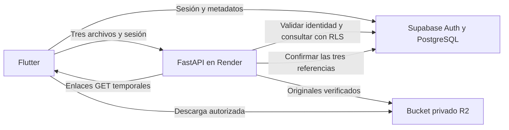

# Decisión de almacenamiento: Cloudflare R2

Decisión del usuario, 5 de noviembre de 2026: guardar los archivos en **Cloudflare R2**. Supabase conserva Auth y PostgreSQL. El servicio de imágenes se prepara para **Render**, con FastAPI y una URL HTTPS, independiente de la computadora local.

## Estado

- Preparado: servicio FastAPI, adaptador R2, validación de archivos, autorización con Supabase, subida de tres fotos, enlaces de lectura y recuperación desde Flutter.
- Preparada: cuarta migración SQL `20261105130000_r2_image_storage.sql`, con proveedor y RPC exclusiva de servidor para confirmar las tres imágenes.
- Preparado: Dockerfile y guía de despliegue en Render.
- Pendiente: habilitar R2, crear el bucket y sus credenciales, configurar el servicio Render, aplicar la migración en Supabase y publicar la API.
- Pendiente: activar `IMAGE_API_URL` y compilar el APK conectado; prueba de extremo a extremo contra R2/Render y en teléfono físico.
- Pendiente, separado de esta etapa: SMTP externo, Google OAuth y servicio de análisis/modelo.

No se ha creado infraestructura, contratado una instancia, obtenido claves privadas ni aplicado la nueva migración en la nube. El APK anterior sigue conservando únicamente metadatos remotos; este trabajo no convierte las fotos anteriores en archivos persistidos.

## Recorrido

El flujo de análisis futuro reutilizará el ID de evaluación y las referencias confirmadas. No se ejecuta el modelo en esta implementación.

## Distribución de datos

| Ubicación | Datos |
|---|---|
| `auth.users`, `profiles` | Cuenta, confirmación, rol y activación |
| `patients`, `evaluations` | Paciente, ojo, observaciones, autor y estado |
| `evaluation_images` | Posición, hash, tamaño, formato, dimensiones, proveedor `cloudflare_r2`, bucket y clave |
| R2 privado | Bytes originales JPEG/PNG |
| Memoria del móvil | Fotos de la captura y caché de consulta; la persistencia definitiva será R2 |
| Secretos de Render | Credenciales de R2 y credencial de servidor de Supabase |

El móvil recibe únicamente la URL pública de FastAPI y conserva su sesión de Supabase. Las políticas RLS de Supabase no se trasladan automáticamente a R2: FastAPI debe comprobarlas antes de cada operación. La RPC exclusiva del servidor vuelve a comprobar permisos y metadatos antes de marcar la carga completa.

## Preparación del bucket y alojamiento

Crear un único bucket privado, propuesto `retinazo-retinas`, clase **Standard**. Mantener `r2.dev` y los dominios públicos desactivados. Las credenciales S3 deben limitarse a lectura/escritura de objetos de ese bucket y almacenarse como secretos del servidor. Los identificadores de las rutas no incluyen nombres o DNI.

El API de carga recibe los bytes y los valida antes de escribir en R2. La descarga se realiza mediante enlaces firmados de corta duración. El APK nativo no necesita CORS de navegador; si se habilita Flutter Web, se definirán explícitamente sus orígenes permitidos tanto en la API como en R2.

R2 Standard incluye actualmente 10 GB-mes de almacenamiento, un millón de operaciones de clase A y diez millones de clase B al mes sin cargo; el excedente se factura. Estos límites no incluyen el servidor Render ni equivalen a un límite duro que garantice gasto cero. Revisar [precios de R2](https://developers.cloudflare.com/r2/pricing/) antes de habilitar facturación.

Render publica el servicio como Web Service HTTPS. Su modalidad Free se suspende por inactividad; para mantener el proceso activo hace falta elegir una instancia de pago antes de desplegar. El modelo futuro requerirá su propia evaluación de recursos.

La guía detallada, las variables y el contrato están en [backend/README.md](../backend/README.md).

## Verificación de la preparación

Pasaron 15 pruebas del backend, 45 de PostgreSQL temporal y 30 de Flutter. El contenedor Docker se construyó y se comprobó su importación en Python 3.12 sin red. Se probaron autenticación, separación de credenciales, validación de archivos, fallos parciales, reintentos, referencias de objetos, confirmación exclusiva de servidor y descarte de descargas alteradas. No se enviaron archivos a R2 ni se publicó una API en Render.
